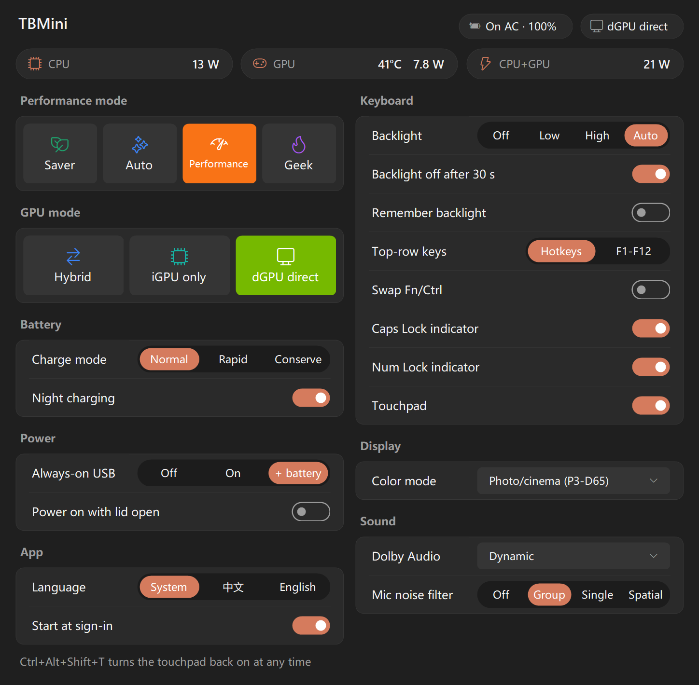
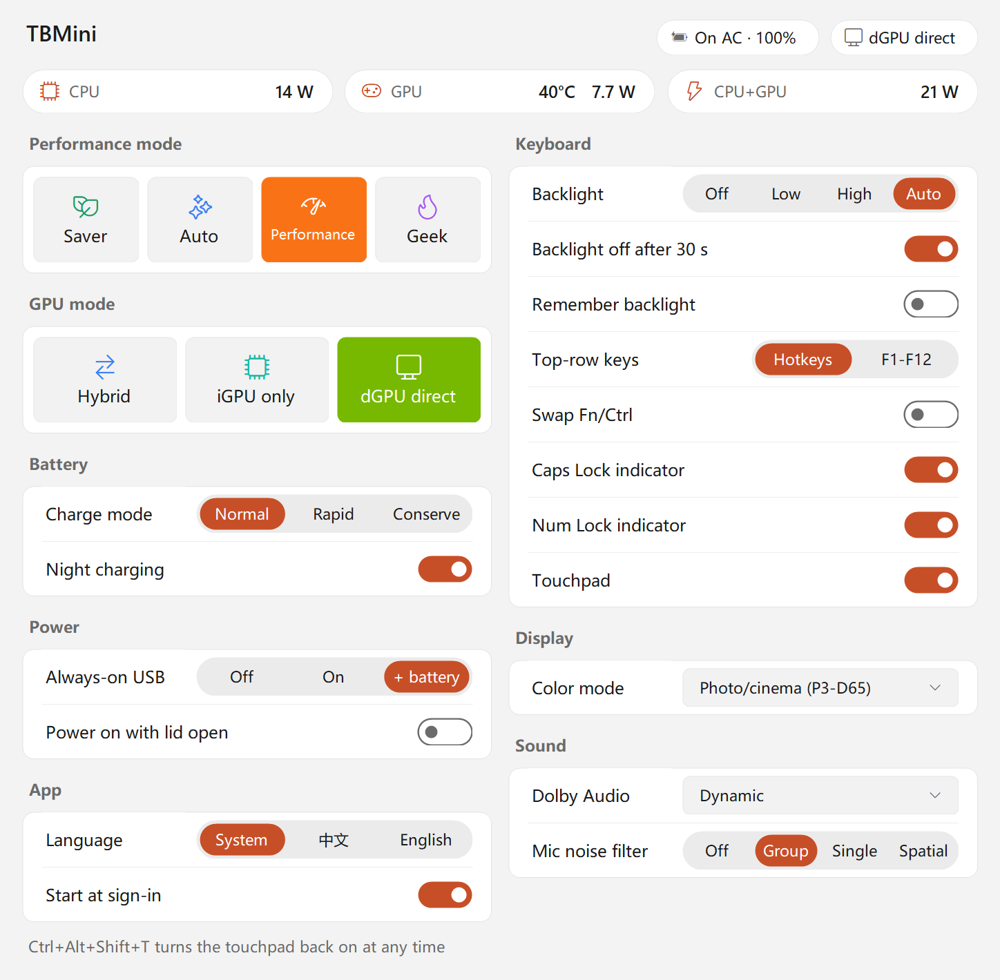

# TBMini

**English** | [简体中文](README.zh-CN.md)

**A tiny tray app that replaces the Lenovo 联想百应 (Baiying) / Vantage UI on the ThinkBook 16p G6.**
Switch the performance mode (including Geek mode), the GPU mode (hybrid / iGPU only / dGPU direct), the battery charge mode, keyboard backlight, Fn lock, color presets, Dolby profile and more, and see live CPU, GPU and total power plus the GPU temperature, all from one small panel without launching Lenovo's apps.
Lenovo's background services and drivers must stay installed: TBMini only replaces their UI.

<p align="center">
  <br>
  
</p>

## Features

| Section | Settings |
|---|---|
| Status bar | Power source and battery level, current GPU mode; CPU power, dGPU temperature and power, total power (refreshed every 1.5 s while the panel is open) |
| Performance mode | Saver / Auto / Performance / Geek (Geek only on AC power; Fn+Q still works and the icon follows it) |
| GPU mode | Hybrid / iGPU only (switches within Hybrid, no restart; has no effect while an app is using the dGPU) / dGPU direct (switching to or from dGPU direct needs a restart; TBMini asks) |
| Battery | Charge mode (Normal / Rapid / Conserve), night charging |
| Power | Always-on USB (Off / On / + battery), power on when the lid opens |
| Keyboard | Backlight (Off / Low / High / Auto), backlight off after 30 s, remember backlight, top-row keys (hotkeys / F1-F12), Fn/Ctrl swap, Caps Lock / Num Lock indicators, touchpad on/off |
| Display | Factory X-Rite color presets for the internal display (D65 / Native / sRGB / P3-D65 / P3-DCI / Adobe RGB / REC709), re-applied automatically after a GPU mode switch |
| Sound | Dolby Audio (Dynamic / Movie / Music / Game / Voice / Custom / Off), AI mic noise suppression (Off / Group / Single / Spatial) |
| App | Language (System / 中文 / English), start at sign-in |

Settings the machine does not support are hidden. BIOS-backed settings are also hidden when TBMini is not running as administrator.

### Temperature and power

- **CPU power:** the Windows "Energy Meter" performance counter (Intel RAPL package power).
- **CPU temperature:** not shown on the ThinkBook 16p G6. Its firmware does not report the CPU temperature to software: Lenovo's `LENOVO_GAMEZONE_DATA.GetCPUTemp` returns "invalid object" and there are no ACPI thermal zones. Reading the CPU's own sensor needs a kernel driver, which TBMini does not install. On Lenovo models whose firmware does implement `GetCPUTemp`, the CPU bubble shows it when TBMini runs as administrator.
- **dGPU temperature and power:** NVML from the NVIDIA driver. When the dGPU is sleeping in Hybrid mode the bubble shows "Asleep", and TBMini never wakes the dGPU just to read it. In iGPU-only mode it shows "Off".
- **Total power:** on battery this is the battery discharge rate, which is the real whole-system power. On AC there is no whole-system power meter to read, so the bubble is relabelled "CPU+GPU" and shows CPU plus dGPU power.
- Readings are taken only while the panel is open. When the panel closes, polling stops and every handle is released, so there is no background power cost.

## Install

1. Download `TBMini-vX.Y.Z-win-x64.zip` from [Releases](https://github.com/FrostFlops/TBmini/releases) and unzip it anywhere. You can check the download against `SHA256SUMS.txt`.
2. Run `TBMini.exe` and accept the UAC prompt (GPU mode and BIOS settings need administrator rights). The exe is not code-signed, so SmartScreen may warn on first launch; choose "Run anyway".
3. Turn on **Start at sign-in** under App in the panel (or right-click the tray icon → Start at sign-in). TBMini copies itself to `C:\Program Files\TBMini` and starts at sign-in as a scheduled task: no UAC prompt, and it also starts on battery.

Requires Windows 10/11 x64 and .NET Framework 4.8 (included in Windows 11). The touchpad switch needs Windows 11 24H2 or later.

### Update

Right-click the tray icon → Exit, then run the new `TBMini.exe`. If Start at sign-in is on, the new version replaces the copy in `C:\Program Files\TBMini` by itself.

### Uninstall

Turn off Start at sign-in → right-click the tray icon → Exit. Then delete the `C:\Program Files\TBMini` folder and the registry key `HKEY_CURRENT_USER\Software\TBMini`.

## Usage

- **Left-click** the tray icon to open the panel. **Right-click** for the menu (language, start at sign-in, exit and so on).
- The tray icon's color and symbol show the current performance mode.
- **Language:** App → Language in the panel, or Language in the tray menu. The change applies immediately. "System" follows the Windows display language: Chinese on Chinese Windows, English otherwise.
- Before the touchpad can be turned off, a USB or Bluetooth mouse-class device must be connected (some keyboards and receivers with mouse functions count). Once it is off, unplugging any mouse that was connected at that moment turns the touchpad back on. While TBMini is running, **Ctrl+Alt+Shift+T** also turns it back on.

### Command line

TBMini is a GUI app: in PowerShell, use `TBMini --status | Out-String` or `--out status.txt` to get the full output. Command-line output uses the same language setting.

```
TBMini --status [--out file]          current state (read-only)
TBMini --features [--out file]        every setting's current value (read-only)
TBMini --sensors [--out file]         temperature and power readings (read-only)
TBMini --power saver|auto|perf|geek   switch the performance mode
TBMini --autostart on|off|status      start at sign-in (on/off need an admin terminal)
TBMini --version
```

## Dependencies and compatibility

TBMini ships no Lenovo or NVIDIA files. It calls components that are already installed, so **do not uninstall the Lenovo Baiying / Lenovo Vantage services**; you just no longer need to open them:

- Performance mode: `LenovoProcessManagement` (the Lenovo Dispatcher service, installed with the drivers)
- Battery, keyboard backlight, Fn lock, always-on USB: the Lenovo ACPI driver (`\\.\EnergyDrv`)
- GPU mode, power on with lid open: the BIOS WMI interface (`Lenovo_SetBiosSetting`); Fn/Ctrl swap: `LENOVO_BIOS_ASSISTANT`
- dGPU temperature and power: the NVIDIA driver's `nvml.dll`; CPU power: the Energy Meter counters built into Windows; CPU temperature (only on models that implement it): `LENOVO_GAMEZONE_DATA`
- Caps Lock / Num Lock indicators: the `LenovoFnAndFunctionKeys` service
- Color presets: the factory X-Rite profiles (`C:\Windows\System32\spool\drivers\color\TPLCD_*.icm`). They have no effect while HDR or "Automatically manage color for apps" is on
- Dolby Audio: the Dolby audio driver and service, plus `DolbyRpcClient.dll` from Lenovo Baiying (copied to the install folder when Start at sign-in is turned on)
- Mic noise suppression: Lenovo Vantage's noise-suppression plugin. Before loading it, TBMini checks its signature with WinVerifyTrust and confirms that Lenovo signed it

Note that uninstalling Lenovo Baiying or Vantage makes Lenovo reset Geek mode, battery conservation and night charging to their defaults.

Tested only on the **ThinkBook 16p G6 IAX**. GPU detection and readings support Intel iGPU + NVIDIA dGPU machines only. TBMini does not check the model: other ThinkBook / IdeaPad / Xiaoxin models that use the same Lenovo interfaces may partly work (unsupported settings are hidden). Use it on other models at your own risk.

## Safety

- **GPU mode** and **power on with lid open** are written to the BIOS through `Lenovo_SetBiosSetting`. TBMini refuses when a BIOS supervisor password is set (change the setting in BIOS setup instead), checks the target value against the BIOS's list of choices when one is provided, tries to discard the change if saving fails, and reads the value back afterwards. **Fn/Ctrl swap** is written to the firmware through `LENOVO_BIOS_ASSISTANT` and read back afterwards.
- The GPU mode actually in effect comes from the hardware (which GPU drives the internal display), so Fast Startup and hibernation do not mislead it. While the internal display is off (lid closed with an external monitor, or "Second screen only"), the current mode cannot be confirmed and GPU switching is refused; turn the internal display on first.
- When switching to dGPU direct with BitLocker on for the system drive, TBMini reminds you to make sure you have the recovery key. Before changing the other BIOS settings (power on with lid open, Fn/Ctrl swap), check this yourself.
- No polling while idle: performance mode changes arrive through registry notifications, and everything else is driven by system events. Temperature and power are read only while the panel is open. The only timer is a check every 15 s for the external mouse, and it runs only while the touchpad is turned off.

This project is not affiliated with or endorsed by Lenovo or NVIDIA. ThinkBook, Lenovo Vantage and 联想百应 are trademarks of Lenovo; NVIDIA is a trademark of NVIDIA Corporation; Dolby is a trademark of Dolby Laboratories. Changing hardware and BIOS settings carries risk; you use this software at your own risk.

## Build from source

Requires the .NET SDK 8 or later (the target framework is .NET Framework 4.8):

```
dotnet build TBMini.csproj -c Release
```

The output is `bin/Release/TBMini.exe`. Pushing a `vX.Y.Z` tag makes GitHub Actions build and publish a release; a `vX.Y.Z-suffix` tag is published as a pre-release.

## Credits

Interface semantics were cross-checked against [Lenovo Legion Toolkit](https://github.com/BartoszCichecki/LenovoLegionToolkit), its community fork [LenovoLegionToolkit-Team/LenovoLegionToolkit](https://github.com/LenovoLegionToolkit-Team/LenovoLegionToolkit), and [ThinkBook Toolkit](https://github.com/lhzlhz419/ThinkBookToolkit).

## License

[GPL-3.0](LICENSE)
