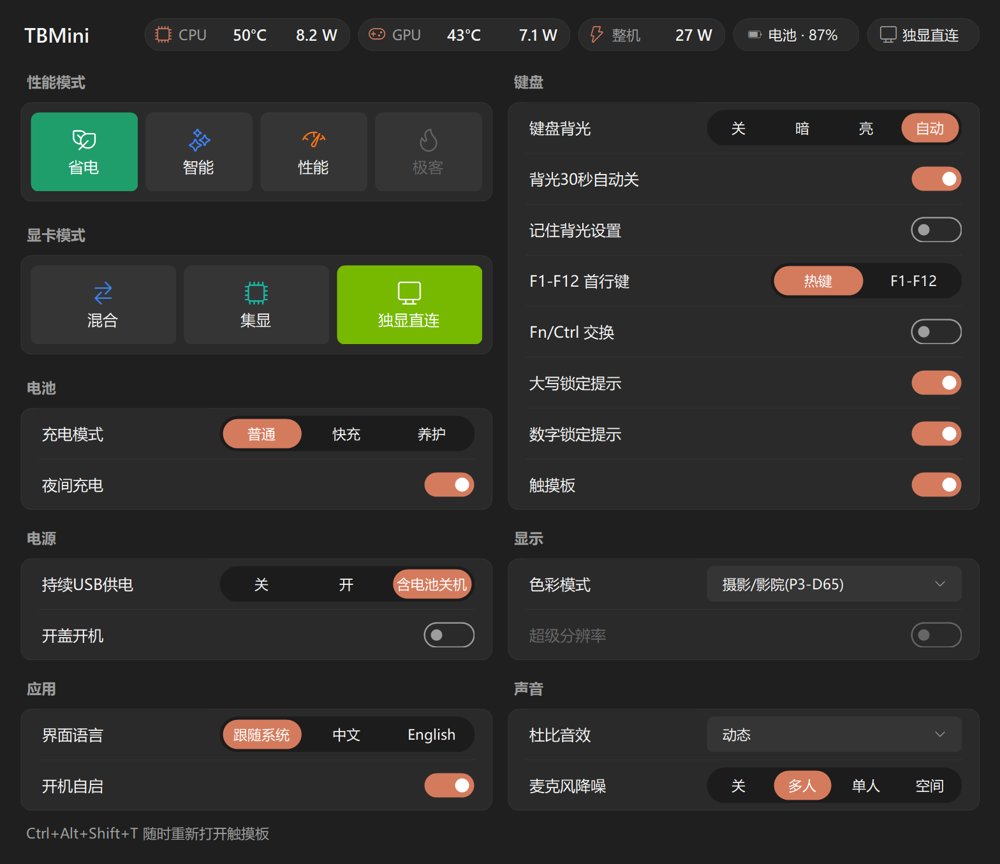
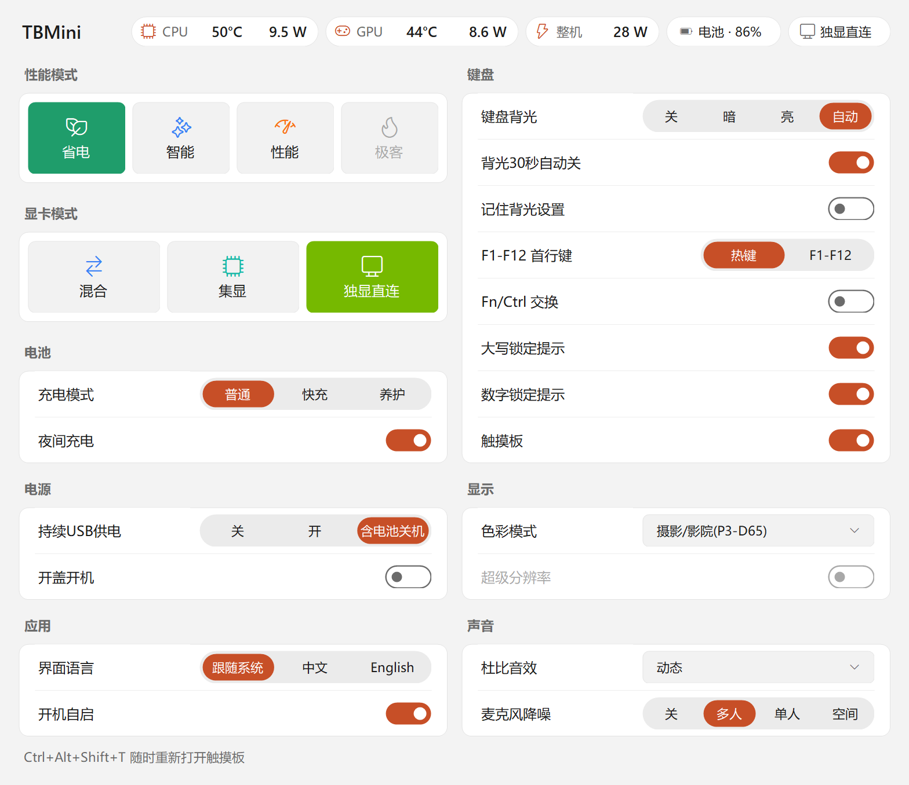

# TBMini

[English](README.md) | **简体中文**

一个极简的托盘工具，用来替代 ThinkBook 16p G6 上「联想百应」的界面。不用再打开联想那一堆软件，就能切换性能模式、显卡模式和常用的硬件设置，还能实时看到 CPU 和显卡的温度与功耗以及整机功耗。
联想的后台服务和驱动仍需保留：TBMini 只替代它们的界面。

<p align="center">
  <br>
  
</p>

## 功能

| 分类 | 设置 |
|---|---|
| 状态栏 | 一行显示：CPU 温度和功耗、独显温度和功耗、整机功耗、电源和电量（充电时附带充电功率，如「接电源 · 82% · +45 W」）、当前显卡模式。读数每 1.5 秒刷新，只在面板打开时读取 |
| 性能模式 | 省电 / 智能 / 性能 / 极客（极客仅接电源时可用；Fn+Q 照常可用，图标会同步） |
| 显卡模式 | 混合 / 集显（在混合模式内切换，不用重启；独显正被程序占用时不生效）/ 独显直连（切入或切出独显直连都需要重启，工具会提示） |
| 电池 | 充电模式（普通 / 快充 / 养护）、夜间充电 |
| 电源 | 持续 USB 供电（关 / 开 / 含电池关机）、开盖开机 |
| 键盘 | 键盘背光（关 / 暗 / 亮 / 自动）、背光 30 秒自动关、记住背光设置、F1-F12 首行键（热键 / F1-F12）、Fn/Ctrl 交换、大写/数字锁定提示、触摸板开关 |
| 显示 | 内屏出厂 X-Rite 色彩预设（D65 / Native / sRGB / P3-D65 / P3-DCI / Adobe RGB / REC709），切换显卡模式后会自动重新应用；Intel 视频超级分辨率（只在内屏由核显驱动时可用，独显直连时显示为灰色） |
| 声音 | 杜比音效（动态 / 电影 / 音乐 / 游戏 / 语音 / 定制 / 关闭）、麦克风 AI 降噪（关 / 多人 / 单人 / 空间） |
| 应用 | 界面语言（跟随系统 / 中文 / English）、开机自启 |

机器不支持的设置项会自动隐藏。没有以管理员身份运行时，BIOS 相关的设置项也会隐藏。

### 温度与功耗

- **CPU 功耗**：Windows 的「Energy Meter」性能计数器（Intel RAPL 封装功耗），不需要驱动。
- **CPU 温度**：CPU 自身的封装温度传感器，通过可选的 [PawnIO](https://pawnio.eu) 驱动读取（LibreHardwareMonitor 和 FanControl 用的也是它）。用 `winget install namazso.PawnIO` 安装；TBMini 需要以管理员身份运行（开机自启时就是）。没装 PawnIO 时 CPU 一格只显示功耗。ThinkBook 16p G6 的固件没有别的途径：联想的 `GetCPUTemp` WMI 调用返回「无效的对象」，也没有 ACPI 温度区域。
- **独显温度和功耗**：NVIDIA 驱动自带的 NVML。混合模式下独显空闲休眠时显示「休眠」，不会为了读数把它唤醒；集显模式下显示「已断开」。
- **整机功耗**：用电池时就是电池的放电功率，即真实的整机功耗。接电源时 ThinkBook 16p G6 完全没有可读的整机功耗：没有 ACPI 功率计，电池报告 0 W，CPU 的平台能量计数器（PSys）也没有接线。所以接电源时这一格改名为「CPU+GPU」，显示 CPU 与独显功耗之和。在接了 PSys 的机型上，装了 PawnIO 后 TBMini 会把它显示为整机功耗。
- **充电功率**：电池充电时，电源那一格会附带充进电池的功率（如「接电源 · 82% · +45 W」）。这只是适配器输出中给电池的那部分，不是整机功耗。电池充满或停在养护上限时读数为 0 W，不显示。
- 只在面板打开时读取。面板关闭后立即停止并释放所有句柄，不增加后台耗电；每次读取约 0.5 毫秒。

## 安装

1. 从 [Releases](https://github.com/FrostFlops/TBmini/releases) 下载 `TBMini-vX.Y.Z-win-x64.zip`，解压到任意位置。附带的 `SHA256SUMS.txt` 可以用来校验下载。
2. 运行 `TBMini.exe`，在 UAC 提示里允许（显卡模式和 BIOS 项需要管理员权限）。程序没有代码签名，第一次运行时 SmartScreen 可能会拦截，选「仍要运行」即可。
3. 在面板「应用」里打开 **开机自启**（或右键托盘图标 → 开机自启）。程序会复制到 `C:\Program Files\TBMini`，并以计划任务方式在登录时启动（不再弹 UAC，电池供电时也会启动）。
4. 可选：安装 [PawnIO](https://pawnio.eu)（`winget install namazso.PawnIO`）即可显示 CPU 温度，详见[温度与功耗](#温度与功耗)。

需要 Windows 10/11 x64 和 .NET Framework 4.8（Windows 11 自带）。触摸板开关需要 Windows 11 24H2 或更高版本。

### 更新

右键托盘图标 → 退出，然后运行新版本的 `TBMini.exe`。如果开着「开机自启」，新版本会自动覆盖 `C:\Program Files\TBMini` 里的旧版本。

### 卸载

关闭「开机自启」→ 右键托盘图标 → 退出，然后删除 `C:\Program Files\TBMini` 文件夹和注册表项 `HKEY_CURRENT_USER\Software\TBMini`。

## 使用

- **左键**托盘图标：打开面板。**右键**：菜单（语言、开机自启、退出等）。面板弹出时有一个很短的滑入动画；在 Windows 设置里关闭「动画效果」后也会一起关闭。
- 托盘图标的颜色和图案表示当前性能模式。
- **界面语言**：面板「应用 → 界面语言」，或右键菜单「语言 / Language」，切换后立即生效。「跟随系统」= Windows 显示语言是中文时用中文，否则用英文。
- 关闭触摸板前必须接有 USB 或蓝牙鼠标类设备（部分带鼠标功能的键盘或接收器也算）。关掉后，只要当时连接的任一鼠标被拔掉，触摸板会自动重新打开。TBMini 运行时，按 **Ctrl+Alt+Shift+T** 也可以重新打开触摸板。

### 命令行

TBMini 是图形界面程序：在 PowerShell 里可以用 `TBMini --status | Out-String` 或 `--out status.txt` 拿到完整输出。命令行输出使用同一个语言设置。

```
TBMini --status [--out file]          当前状态（只读）
TBMini --features [--out file]        所有设置项的当前值（只读）
TBMini --sensors [--out file]         温度和功耗读数（只读）
TBMini --power saver|auto|perf|geek   切换性能模式
TBMini --autostart on|off|status      开机自启（on/off 需要在管理员终端里运行）
TBMini --version
```

## 依赖与兼容性

TBMini 本身不包含任何联想或 NVIDIA 的文件，它调用的是机器上已经安装的组件，所以**请不要卸载联想百应 / Lenovo Vantage 服务**，只是不用再打开它们：

- 性能模式：`LenovoProcessManagement`（Lenovo Dispatcher 服务，随驱动安装）
- 电池、键盘背光、Fn Lock、持续 USB 供电：联想 ACPI 驱动（`\\.\EnergyDrv`）
- 显卡模式、开盖开机：BIOS 的 WMI 接口（`Lenovo_SetBiosSetting`）；Fn/Ctrl 交换：`LENOVO_BIOS_ASSISTANT`
- 独显温度和功耗：NVIDIA 驱动的 `nvml.dll`；CPU 功耗：Windows 自带的 Energy Meter 计数器；电池放电功率：Windows 的电池驱动
- CPU 温度（可选）：[PawnIO](https://pawnio.eu) 驱动（需自行安装）。TBMini 内嵌 PawnIO 官方签名的 `IntelMSR` 模块，它只能读取固定的几项 CPU 寄存器（LGPL-2.1，见 [third_party/PawnIO](third_party/PawnIO)）；加载 PawnIO 的库之前会先校验其签名
- 大写/数字锁定提示：`LenovoFnAndFunctionKeys` 服务
- 超级分辨率：Intel 显卡控制库（`ControlLib.dll`，随 Intel 显卡驱动安装），与联想自带的超级分辨率开关调用的是同一个接口
- 色彩模式：出厂预装的 X-Rite 校色文件（`C:\Windows\System32\spool\drivers\color\TPLCD_*.icm`）。开着 HDR 或「自动管理应用颜色」时预设不生效
- 杜比音效：Dolby 音频驱动/服务，以及联想百应自带的 `DolbyRpcClient.dll`（开启「开机自启」时会复制一份到安装目录）
- 麦克风降噪：Lenovo Vantage 的降噪插件（加载前会用 WinVerifyTrust 校验文件签名，并确认签名者是联想）

另外，卸载联想百应 / Vantage 时，联想会把极客模式、电池养护、夜间充电恢复成默认值。

目前只在 **ThinkBook 16p G6 IAX** 上测试过。显卡检测和读数只支持 Intel 核显 + NVIDIA 独显的机型。程序不做机型检查：其他使用同一套联想接口的 ThinkBook / IdeaPad / 小新可能部分可用（不支持的设置项会隐藏），在其它机型上使用风险自负。

## 安全说明

- **显卡模式**和**开盖开机**通过 `Lenovo_SetBiosSetting` 写入 BIOS：BIOS 设有管理员密码时会直接拒绝（请进 BIOS 修改）；BIOS 提供可选值列表时会校验目标值；保存失败会尝试撤销；写入后会读回校验。**Fn/Ctrl 交换**通过 `LENOVO_BIOS_ASSISTANT` 写入固件，写入后读回校验。
- 当前实际生效的显卡模式以硬件为准（内屏挂在哪块显卡上），不会被快速启动 / 休眠误导。内屏没点亮时（合盖外接显示器、仅第二屏幕模式）无法确认当前模式，显卡切换会被拒绝，请先打开内屏。
- 切换独显直连时，如果检测到系统盘开着 BitLocker，工具会提醒你先确认手里有恢复密钥。修改其它 BIOS 项（开盖开机、Fn/Ctrl 交换）前，请自行确认。
- 空闲时不轮询：性能模式的变化通过注册表通知获得，其它都由系统事件驱动。温度和功耗只在面板打开期间读取；点到别处、锁屏、关闭屏幕或睡眠时面板会自动收起。另外只有在触摸板被关闭期间，才会每 15 秒检查一次外接鼠标是否还在。

本项目与联想（Lenovo）、NVIDIA 无关，也未获得它们的认可。ThinkBook、Lenovo Vantage、联想百应是联想的商标；NVIDIA 是英伟达的商标；Dolby 是杜比实验室的商标。修改硬件和 BIOS 设置有风险，使用本软件即表示你自行承担风险。

## 从源码构建

需要 .NET SDK 8 或更高版本（目标框架是 .NET Framework 4.8）：

```
dotnet build TBMini.csproj -c Release
```

输出在 `bin/Release/TBMini.exe`。推送 `vX.Y.Z` 标签会由 GitHub Actions 自动构建并发布 Release；`vX.Y.Z-xxx` 形式的标签会发布为预发布版本。

## 致谢

接口语义参考了 [Lenovo Legion Toolkit](https://github.com/BartoszCichecki/LenovoLegionToolkit)、它的社区维护分支 [LenovoLegionToolkit-Team/LenovoLegionToolkit](https://github.com/LenovoLegionToolkit-Team/LenovoLegionToolkit)，以及 [ThinkBook Toolkit](https://github.com/lhzlhz419/ThinkBookToolkit)。CPU 温度使用了 namazso 的 [PawnIO](https://pawnio.eu) 及其 [IntelMSR 模块](https://github.com/namazso/PawnIO.Modules)。

## 许可证

[GPL-3.0](LICENSE)
